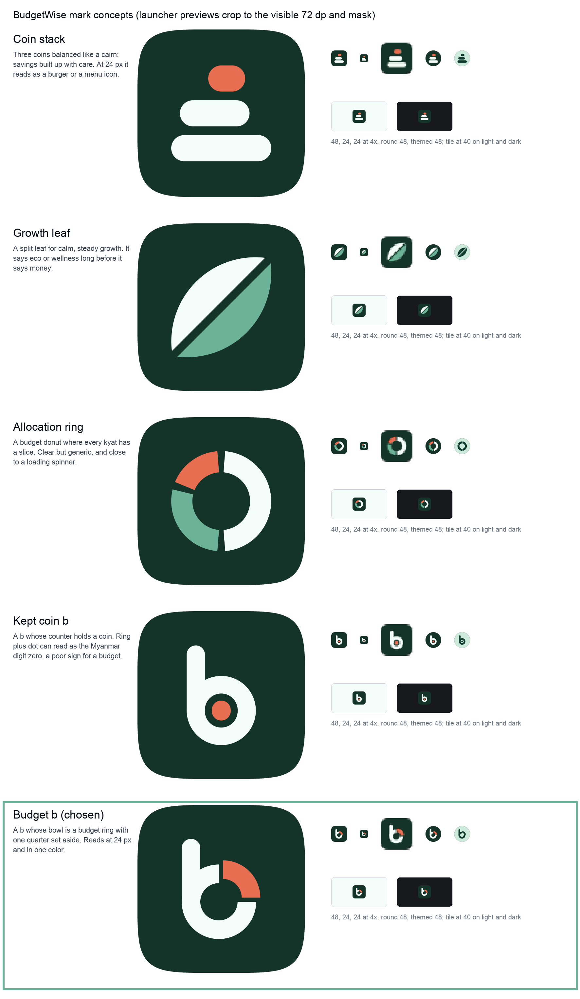

# BudgetWise brand mark



## The mark: "budget b"

A lowercase **b** whose bowl is a budget ring. One quarter of the ring is lifted out and set aside in coral.

- The **b** is BudgetWise, readable as a letter at any size.
- The **ring** is the month's money, the donut chart every budget screen already shows.
- The **coral quarter** is the part you put aside before you spend: savings, a goal, the kyat you did
  not waste. It moves up and to the right, away from the rest, which is what money handled wisely does.

It is built only from a bar and a ring, so it holds up at 16 px, works in one color, and stays inside the
Android adaptive icon safe zone.

## Construction (108 dp adaptive icon grid)

| Part | Geometry |
|---|---|
| Bowl | ring centered at (53, 59.5), outer radius 16, inner radius 8 (stroke 8) |
| Stem | 8 wide (x 37 to 45), from y 32.5 (round cap, radius 4) down to the bowl's center line |
| Quarter | the ring's 12 to 3 o'clock segment, moved 2.5 dp out along 45 degrees |
| Extent | 43 dp tall, 34 dp wide, centered on (54, 54); farthest point 25.8 dp from center, inside the 60 dp circle and the 66 dp safe zone |

The stem's inner edge is tangent to the counter, so stem and bowl share one stroke weight.

## Files

| File | Use |
|---|---|
| `logo-mark.svg` | Primary logo: the forest tile with the mark, 72 x 72 (the launcher's visible area). Web header, favicon, avatars. |
| `logo-mark-mono.svg` | The glyph in one color (`currentColor`), same 72 frame. Themed icons, notification icons, print, embossing. |
| `logo-wordmark.svg` | Tile plus "BudgetWise" in Open Sans Bold, outlined (no font needed). For light backgrounds. |
| `icons/app-foreground.svg` | Adaptive icon foreground for `:app`. `data-background` holds the background color. |
| `icons/voicelab-foreground.svg` | Adaptive icon foreground for `:asr-demo` (BudgetWise Voice Lab). |
| `concepts/` | The five explored concepts (SVG, 512 px and 48 px renders) and `contact-sheet.png`. |
| `previews/` | `launcher-icons.png` (rendered from the generated VectorDrawable XML) and `web-header.png`. |
| `render.py` | Regenerates every raster and Android vector from the SVGs above. |

Regenerate after editing any SVG (requirements are in the script header; nothing is added to the repo's
dependencies):

```sh
uv venv /tmp/brand-venv && VIRTUAL_ENV=/tmp/brand-venv uv pip install cairosvg Pillow
DYLD_FALLBACK_LIBRARY_PATH=/opt/homebrew/lib /tmp/brand-venv/bin/python brand/render.py
```

It writes `apps/web/public/logo.png` (512 px), `apps/web/public/favicon.ico` (16, 32, 48 px, cropped tighter so the b stays
legible at 16 px), the `ic_launcher_foreground.xml`, `ic_launcher_monochrome.xml` and
`ic_launcher_background.xml` resources of both Android apps, the concept renders and the previews. Icon
sources must stay flat: `<path d fill>` elements only, no transforms, strokes, masks or text, because they are
copied straight into VectorDrawable path data.

## Colors

| Role | Value | Notes |
|---|---|---|
| Sage | `#6CB299` | Web `--primary`. Brand color for fills and charts; light theme `primaryContainer`, dark theme `primary`. |
| Forest (tile) | `#143429` | Derived from sage's hue. Icon background; text on sage. |
| Mint (glyph) | `#F3FCF8` | Web `--background`. The b on the tile. |
| Coral (quarter) | `#E76E50` | Web `--chart-1`. The set-aside quarter; light theme `tertiaryContainer`. |
| Blue (Voice Lab) | `#588CB6` | Web `--accent`. Voice Lab tile; light theme `secondaryContainer`. |
| Ink (wordmark) | `#030712` | Web `--foreground`. Use `#F9FAFB` on dark backgrounds. |

Contrast of the mark (WCAG, 3:1 needed for graphics): mint glyph on forest 12.94:1, coral quarter on forest
4.34:1, mint glyph on Voice Lab blue 3.44:1. Wordmark: ink on mint 19.26:1, light on the dark background
16.85:1. White on sage is only 2.48:1, which is why the tile is forest.

### In the Compose theme

The brand hues are too light to be text on light surfaces (sage 2.37:1, blue 3.44:1, coral 2.98:1 on mint), and
Material 3 draws `primary`, `secondary` and `tertiary` as text (text buttons, links, selected labels). So the
light theme uses deeper shades of the same hues for those roles and keeps the exact brand hues in the
containers. The dark theme keeps brand sage as `primary` and lightens blue and coral.

| Role | Light | Dark |
|---|---|---|
| `primary` / `onPrimary` | `#26644E` / white, 6.96:1 | `#6CB299` (brand) / forest, 5.45:1 |
| `secondary` / `onSecondary` | `#305B7E` / white, 7.18:1 | `#89B1D2` / ink, 8.90:1 |
| `tertiary` / `onTertiary` | `#9C351C` / white, 7.14:1 | `#F08E75` / ink, 8.47:1 |
| `primaryContainer` / on | `#6CB299` (brand) / forest, 5.45:1 | `#1F4F40` / `#CDEBDD`, 7.34:1 |
| `secondaryContainer` / on | `#588CB6` (brand) / `#081A2A`, 4.90:1 | `#1D3B53` / `#D6E6F3`, 9.14:1 |
| `tertiaryContainer` / on | `#E76E50` (brand) / `#3A1006`, 5.37:1 | `#6E2A1A` / `#FBDCD3`, 8.10:1 |

Text roles on the weakest surface they can sit on: light theme primary 5.01:1, secondary 5.17:1, tertiary
5.14:1, error 4.65:1, onSurfaceVariant 6.71:1 (all on `surfaceDim`); dark theme primary 4.82:1, secondary
5.29:1, tertiary 5.03:1, onSurfaceVariant 4.71:1 (all on `surfaceBright`). Inverse pairs (snackbars): light
7.62:1 for the action and 11.65:1 for the text, dark 5.51:1 and 10.79:1. `BrandColorsTest` asserts 4.5:1 for
every text role on every surface, background and container role, so a palette change that breaks AA fails
the build.

## Clear space and minimum size

- Clear space: at least a quarter of the tile's width on every side (18 units on the 72 grid). For the bare
  glyph, at least two stroke widths (16 units).
- Minimum size: tile 16 px (the favicon); glyph 12 px tall; wordmark lockup 96 px wide.

## Do

- Use the tile on any background; it carries its own contrast.
- Use the mono glyph in one solid color when color is not available or the system tints it (Android themed
  icons use `ic_launcher_monochrome.xml`).
- Keep the gap between the quarter and the ring; it is what reads as "set aside".

## Don't

- Recolor the quarter to sage or blue, or color the b in coral.
- Close the gap, rotate or mirror the mark, or move the quarter to another position.
- Place the mint glyph straight on a light background or the sage glyph on mint (2.37:1).
- Use the brand sage, blue or coral as text on light backgrounds; use the deeper theme shades above.
- Add outlines, gradients, shadows or a stroke around the tile.
- Use the Voice Lab variant for the BudgetWise app; it marks the internal voice demo only.

## Voice Lab variant

The voice demo (`:asr-demo`, label "BudgetWise Voice Lab") uses the same b on the blue accent tile, with the
coral quarter replaced by two sound waves. Same silhouette, different color: the two apps are told apart at a
glance on the home screen and still look like one family.

## Concepts explored

1. **Coin stack**: three coins balanced like a cairn. Warm idea, but at 24 px it reads as a burger or a
   menu icon.
2. **Growth leaf**: calm growth. It says eco or wellness before it says money.
3. **Allocation ring**: a budget donut. Clear, but generic and close to a loading spinner.
4. **Kept coin b**: a b whose counter holds a coin. Strong at small sizes, but a ring with a center dot
   matches how some Myanmar fonts draw the digit zero, a poor sign on a budget.
5. **Budget b** (chosen): keeps the letter, the chart and the saving in one shape, and survives one color.

Not yet checked with a Burmese reader; worth a quick look that the mark carries no unintended reading.

## Web notes

`src/components/layout/app-header.tsx` keeps using `/logo.png`. `src/app/icon.svg` is not added: the root
layout sets `metadata.icons`, and Next.js only applies file-based icons when that field is absent, so the file
would be ignored without a code change.

The wordmark is Open Sans Bold 1.10 (Apache License 2.0), outlined into paths.
