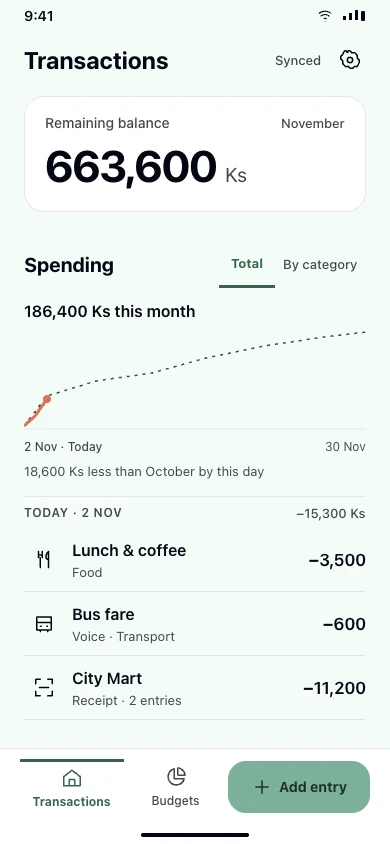
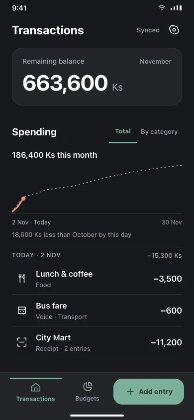

# Approved Android Draft 3

[Editable Paper file](https://app.paper.design/file/01M637VVENYNCKYK0T90TRWSMT/p-4-0)

Snapshot from 2026-11-02, based on master `10ec22f96e6fde5b9f5e6f242bae01dc8649cfab` (entries-v3). The user selected Draft 3 and then approved the compact bank-style remaining-balance treatment on the first screen. The full-width forest masthead is superseded.

 

## UI-only scope

See [native implementation mapping and verification](IMPLEMENTATION.md) for the code changes, supported interactions and remaining review limits.

This PR translates the approved composition into the native Android app using its existing theme, Schibsted Grotesk/Padauk typography, real state and callbacks. It preserves the entries-v3 workflows, whole-kyat amounts, real system keyboard, actual camera preview and existing error/offline states. The sample data and keypad/receipt illustrations in Paper are design references, never production data or substitute controls.

Budget editing is being developed independently on `feat/android-budgets`. Its worktree was dirty when this PR began and has not been modified or copied. That workstream owns budget screens, APIs, persistence, validation, migrations and feature behavior. The budget snapshots here record the read-only master baseline; they are not authority to discard the upcoming editing feature. When that PR exists, integrate its behavior first and apply this shared visual language while keeping every budget action/state. This branch is based directly on master, not on the unfinished budget branch.

The design-skills and web Paper Shaders installation remain in [PR #10](https://github.com/codes71/BudgetWise/pull/10). They are not duplicated into this UI branch. Native Android uses compatible Compose presentation and approved static shader image output, not a React runtime or new backend dependency.

## Reference files

- `manifest.json`: all 40 views, dimensions, exact source files and preview filenames.
- `source/*.json`: exact Paper JSX, fetched directly with node IDs excluded. Use the numeric values/tokens to implement; screenshots are for visual comparison.
- `tokens.json`: the file's ledger token set, preserving the app's light/dark brand roles.
- `previews/*.webp`: native Paper exports of 20 light and 20 dark views at390×844.

The welcome atmosphere uses the original deterministic MeshGradient stills generated with Paper Shaders0.0.82 (speed0, frame3200, existing sage/forest palette). Native resources are static, decorative and supported on minSdk26. No continuously running shader, API33 requirement or animation is implied.

## Screen index

| Screen/state | Light | Dark |
| --- | --- | --- |
| 1. Transactions | [Light](previews/01-transactions-light.webp) | [Dark](previews/01-transactions-dark.webp) |
| 2. Add entry | [Light](previews/02-add-entry-light.webp) | [Dark](previews/02-add-entry-dark.webp) |
| 3. Voice · listening | [Light](previews/03-voice-listening-light.webp) | [Dark](previews/03-voice-listening-dark.webp) |
| 4. Scan · receipt camera | [Light](previews/04-scan-receipt-camera-light.webp) | [Dark](previews/04-scan-receipt-camera-dark.webp) |
| 5. Budgets | [Light](previews/05-budgets-light.webp) | [Dark](previews/05-budgets-dark.webp) |
| 6. Settings | [Light](previews/06-settings-light.webp) | [Dark](previews/06-settings-dark.webp) |
| 7. Language | [Light](previews/07-language-light.webp) | [Dark](previews/07-language-dark.webp) |
| 8. Welcome | [Light](previews/08-welcome-light.webp) | [Dark](previews/08-welcome-dark.webp) |
| 9. Create account | [Light](previews/09-create-account-light.webp) | [Dark](previews/09-create-account-dark.webp) |
| 10. Sign in | [Light](previews/10-sign-in-light.webp) | [Dark](previews/10-sign-in-dark.webp) |
| 11. First income | [Light](previews/11-first-income-light.webp) | [Dark](previews/11-first-income-dark.webp) |
| 12. Voice setup | [Light](previews/12-voice-setup-light.webp) | [Dark](previews/12-voice-setup-dark.webp) |
| 13. Add sheet | [Light](previews/13-add-sheet-light.webp) | [Dark](previews/13-add-sheet-dark.webp) |
| 14. Receipt detail | [Light](previews/14-receipt-detail-light.webp) | [Dark](previews/14-receipt-detail-dark.webp) |
| 15. Check receipt | [Light](previews/15-check-receipt-light.webp) | [Dark](previews/15-check-receipt-dark.webp) |
| 16. Move category | [Light](previews/16-move-category-light.webp) | [Dark](previews/16-move-category-dark.webp) |
| 17. Change items | [Light](previews/17-change-items-light.webp) | [Dark](previews/17-change-items-dark.webp) |
| 18. Change entry | [Light](previews/18-change-entry-light.webp) | [Dark](previews/18-change-entry-dark.webp) |
| 19. Check payment | [Light](previews/19-check-payment-light.webp) | [Dark](previews/19-check-payment-dark.webp) |
| 20. Check payments | [Light](previews/20-check-payments-light.webp) | [Dark](previews/20-check-payments-dark.webp) |

## Review status

The drafts were reviewed in Paper against the current master capabilities. Follow-up corrections include recording without a live transcript, email/password-only signup (six-character minimum), income-source selection, the Settings cloud-text toggle, count/price-only saved-item editing, previous-value notes and access to all categories. Primary text-role contrast was checked. The remaining-balance revision was checked in both themes and the Add-sheet backdrop copies.

Better Design automated comprehension/spacing review is unavailable because its service quota is exhausted. No automated design approval or device acceptance is claimed. This static snapshot does not verify native font scaling, keyboard behavior or accessibility semantics; the implementation must keep the existing adaptive/scroll/accessibility behavior and pass its native checks. Secondary error, empty and download variants remain governed by the current app rather than invented from happy-path mockups.
